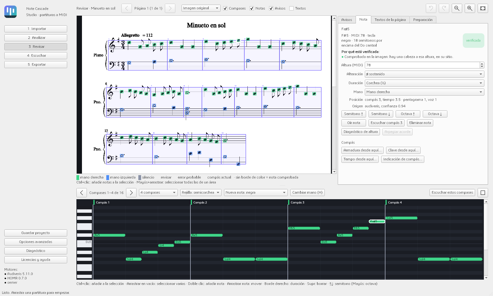
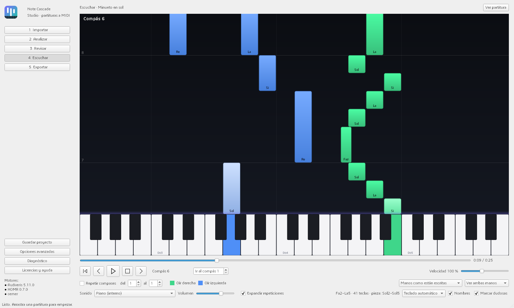

# Note Cascade Studio

Conversor **local y gratuito** de partituras (PDF, fotos, capturas de pantalla) a **MIDI** editable, con
revisión asistida para quien no sabe leer partituras y un visualizador de notas **en cascada** al estilo de
los tutoriales de piano. Interfaz en español para Windows 10 y 11.

> **Versión beta.** El reconocimiento de partituras (OMR) nunca es perfecto: el programa marca lo que hay que
> revisar y explica por qué, pero conviene escuchar el resultado y compararlo con la partitura. Lo que se sabe
> que falla está en [`LIMITACIONES.md`](LIMITACIONES.md).

- Funciona sin conexión una vez instalado. Las partituras **nunca** se suben a internet.
- Reconoce la música con [Audiveris](https://github.com/Audiveris/audiveris) y
  [HOMR](https://github.com/liebharc/homr), y comprueba cada nota con la propia imagen.
- Exporta MIDI (tipo 1 con una pista por mano, o tipo 0), MusicXML, un informe y el proyecto para seguir
  corrigiendo más tarde.

*Revisar: cada nota reconocida se marca sobre la partitura (verde, mano derecha; azul, mano izquierda) y el
panel explica por qué está verificada o qué hay que revisar.*

*Escuchar: las notas caen sobre el teclado, con bucles, velocidad y manos por separado.*

Ejemplo: *Minueto en sol* de Christian Petzold (dominio público), con un bajo sencillo, dibujado para la
prueba y reconocido sin errores (87 de 87 notas).

## Descargar

- **Programa listo para usar:** en [Releases](../../releases) está la carpeta comprimida con
  `NoteCascadeStudio.exe` (incluye Audiveris y los modelos de HOMR; ocupa unos 940 MB al descomprimir).
  Descomprímela entera y abre el `.exe`. Windows puede avisar de que el programa no está firmado:
  *Más información → Ejecutar de todas formas*. En la página de la versión está la huella SHA-256 del zip
  para comprobar que la descarga no se ha modificado.
- **Desde el código:** descarga este repositorio y ejecuta `install_windows.bat` (descarga y verifica
  Python, las bibliotecas, Audiveris y los modelos) y luego `run_windows.bat`.

## Documentación

| Archivo | Contenido |
|---|---|
| [`README_ES.md`](README_ES.md) | Manual completo: instalación, los cinco pasos, revisión, escucha, exportación, opciones |
| [`LIMITACIONES.md`](LIMITACIONES.md) | Qué reconoce bien, qué no y cómo se corrige |
| [`docs/RESULTADOS_PRUEBAS.md`](docs/RESULTADOS_PRUEBAS.md) | Pruebas automáticas y con partituras reales |
| [`docs/Simbolos_y_orden_de_lectura.pdf`](docs/Simbolos_y_orden_de_lectura.pdf) | Qué símbolos se leen y qué efecto tienen |
| [`LICENCIAS_TERCEROS.md`](LICENCIAS_TERCEROS.md) | Componentes de terceros y sus licencias |

## Informar de un problema o proponer una mejora

Abre un [aviso en GitHub](../../issues/new/choose). En el programa, *Diagnóstico → Informar de un problema…*
copia antes el diagnóstico (sin el nombre de tu carpeta de usuario) para pegarlo. Adjunta partituras solo si
son tuyas o de dominio público; si no, basta una captura del compás que falla.

Versión actual: **1.0.0 beta 1**. Solo se ha probado en Windows 11; los avisos desde Windows 10 u otros equipos
son especialmente útiles.

## Licencia

**GNU AGPL-3.0 o posterior** ([`LICENSE`](LICENSE)), porque usa componentes AGPL (HOMR, Audiveris,
PyMuPDF). Puedes usarlo, estudiarlo, modificarlo y redistribuirlo; si lo distribuyes, debes ofrecer también el
código fuente bajo la misma licencia. Detalles y licencias de cada componente en
[`LICENCIAS_TERCEROS.md`](LICENCIAS_TERCEROS.md).

El programa no incluye partituras. Las que conviertas pueden tener derechos de autor: usa solo las que
tengas permiso para usar.
